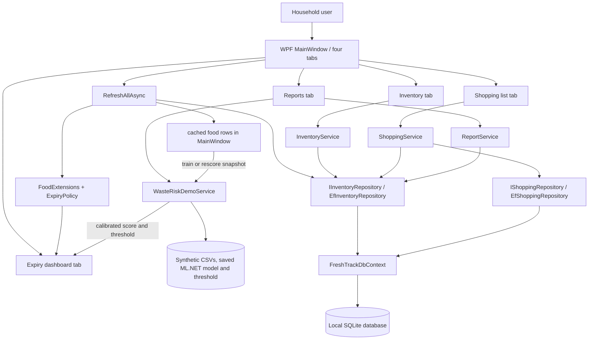

# FreshTrack — report writer handoff

This handoff records the implemented project and verification available through **14 October 2026**. It is source material for the group's own **1500–2000 English word PDF**, not the final report. Do not describe a planned feature as implemented. Section 5 proposes a three-person explanation and two-writer report handoff; it does not establish historical human code authorship.

## 1. Project facts summary

| Item | Verified fact |
| --- | --- |
| Project | FreshTrack — Household Food Inventory and Expiry Manager |
| Target user/problem | A household member using one Windows PC to track food, see expiring items, prepare shopping, and quantify food waste. |
| Completed functions | Food add/edit/delete/search; purchase/expiry dates and quantity; partial or full Used/Wasted recording; dashboard with date-based Expired and model-based High risk/Lower risk priority, plus separate date status and filter; shopping add/delete/purchase transfer; category and monthly totals; waste bar chart; input validation and feedback; synthetic-data ML training/testing, per-food scores and category risk display on Reports. |
| Stack | C#; WPF; .NET 9; Entity Framework Core 9.0.9; SQLite; LINQ; ML.NET 5.0.0; NUnit 4.3.2. |
| How to run | Open `FreshTrack.sln` in Visual Studio 2022 17.12+ with .NET desktop development, select `FreshTrack.App`, restore packages, press F5. CLI instructions are in `ReadMe.md`. |
| Data | `%LOCALAPPDATA%\FreshTrack\freshtrack.db`; created on first launch; five food and two shopping sample rows only on initial schema creation. |
| ML demo data | `%LOCALAPPDATA%\FreshTrack\ml-demo` stores reproducible synthetic training/test CSVs, `waste_demo_model_v2.zip`, and `waste_demo_threshold_v2.txt`; these records are separate from SQLite inventory. The 40,000-row training file supplies an internal 80/20 fit/calibration split; a separate 10,000-row simulator test file is held out for final evaluation. Illustrative profiles include one-day meat, milk, bread, produce, pantry, and frozen examples. The checked training set contained 1,790 one-day meat examples and a 54.6% simulated unused-label rate. |
| Not completed | Real-world waste model or validation on real outcomes; external database/service; external API; cloud sync; accounts; PDF report; Canvas submission; project registration. Local SQLite should **not** be asserted to meet the distinct “external database with LINQ” bonus. A machine-learning bonus award is the tutor's decision. |

## 2. Introduction and Summary of Project — English material

**The final Introduction must contain at least 250 English words.** The following is a factual draft for the report writer to edit and expand after checking the latest code and screenshots:

> Food waste in a household can result from simple failures of visibility: people may buy the same item twice, overlook an expiry date, or forget what is already in the refrigerator or pantry. FreshTrack was developed as a Windows desktop tool to make these decisions easier. Its target user is a household member who wants one place to record food stock, review items that need attention, plan shopping, and see how much food has been used or wasted. The application is intentionally focused on a single local household database, so it can be demonstrated without creating an online account or depending on a remote service.
>
> The Inventory screen allows a user to add, edit, delete, and search food records. Each record stores a name, category, quantity, purchase date, expiry date, and optional notes. A user can mark all or part of a quantity as used or wasted. When only part is recorded, the remaining quantity stays in stock and a history row keeps the used or wasted amount. Repeated records with the same food details, outcome, and day are combined. This supports later reporting without losing the current inventory count. Validation rejects blank names, nonpositive quantities, purchase dates in the future, and expiry dates before purchase.
>
> The Expiry Dashboard shows actual expiry dates and a model-based attention priority. Items past their entered date are marked Expired. Other items are grouped into High risk or Lower risk according to a threshold calibrated on synthetic training data; their separate Date status column still shows whether they are Soon or Fresh under the category warning policy. The filter can select either attention priority or factual Date: Soon/Fresh. This avoids calling a far-dated but potentially wasted item “expiring soon.” The Shopping List screen records planned purchases. The Purchased checkbox records the purchase without changing inventory. After selecting that purchased row and choosing an expiry date, the user clicks Add selected purchase to inventory; the app then creates a food record and removes the shopping row in one database save. The Reports screen presents quantity totals by food category and month, together with a waste bar chart. An ML.NET demonstration generates 40,000 synthetic training records and 10,000 independently seeded test records, fits a logistic regression classifier, calibrates a priority threshold without using the held-out test set, scores each unexpired food item, and groups scores by category; expired rows display no score. Stock changes are rescored using the saved model. The model does not train on real waste outcomes, so its test metrics do not establish household prediction accuracy. The four screens share inventory data through services backed by Entity Framework Core and a local SQLite database. The current shopping flow passed service and migration tests, while its complete GUI sequence still needs a manual check. Nine NUnit tests passed.

## 3. Development Approach

The implemented structure separates UI event handling (`FreshTrack.App/MainWindow.xaml.cs`) from domain/data logic (`FreshTrack.Core`). `MainWindow.xaml` uses a resizable grid layout with four functional tabs. `FoodItem` and `ShoppingItem` are EF entities in `FreshTrack.Core/Models.cs`. `FreshTrackDbContext.cs` maps them to SQLite; `Repositories.cs` contains `IInventoryRepository`, `IShoppingRepository`, and EF implementations. `InventoryService.cs` validates and updates stock and records Used/Wasted quantities. `ShoppingService.cs` records a purchase separately, then adds the food row and removes its shopping row in one shared EF context/save. `Expiry.cs` uses polymorphic `ExpiryPolicy` classes for category-specific warning windows; `FoodExtensions.ExpiryStatus` is the extension method used by the dashboard and reports. `ReportService.cs` uses LINQ grouping, lambda expressions, and an explicit anonymous `Func<FoodItem,bool>` delegate for recent activity selection.

`WasteRiskDemoService.cs` produces seeded synthetic rows from illustrative food profiles. The generator first chooses a category/profile and shelf life, then samples elapsed days and calculates remaining days as `shelf life − elapsed days`; quantity is sampled separately. A stochastic household consumption process, with an unobserved planning factor, marks whether any units remain unused at the entered date. For already overdue rows it uses a separate illustrative probability that varies by category. This replaces the earlier fixed log-odds label equation. The ML.NET `SdcaLogisticRegression` binary classifier uses one-hot category, shelf-life days, days remaining, within-three-days/expired flags, quantity, units per remaining day, and an Australian-summer indicator. It first fits a preliminary model on about 32,000 of the 40,000 training rows, then selects a 50–85% threshold on about 8,000 calibration rows by maximizing F1 subject to at least 80% calibration precision. It refits the final model on all 40,000 rows, evaluates AUC and threshold-specific F1/precision/recall on the untouched 10,000-row test file, saves the model and threshold, scores individual unexpired in-stock items, and uses LINQ to group results by category; expired rows display no score and are excluded from the average. `ScoreSavedModel` reloads the trained model after inventory changes. The separate **Date status** (Expired/Soon/Fresh) is a deterministic date rule. The attention priority is **Expired** when the date has passed, otherwise **High risk** when the simulated model score meets the saved threshold, or **Lower risk**. Thus the model controls the nonexpired attention label without changing the factual date. The shelf-life profiles were informed by the linked USDA/FoodSafety.gov storage guidance but remain examples, not universal limits or substitutes for labels. FSANZ distinguishes use-by from best-before dates; this project does not store that distinction, so an expired item must not be described automatically as unsafe. The category mix, age distribution, quantity mix, household-use rates and latent planning factor are developer assumptions, not empirical estimates. Neither the AUC nor category percentages validate prediction for real households. Output CSV/model files are separate from `freshtrack.db`.

Development sequence: specification review; solution and domain layer; WPF screens; EF persistence and first-run data; NUnit boundary/integration tests; Windows GUI and SQLite checks; synthetic-data ML.NET feature and held-out test; final documentation. This describes this delivered code, not an unverified earlier team process.

| Dependency/tool | Actual version or use | Evidence |
| --- | --- | --- |
| .NET SDK | 9.0.318 used for verification; targets `net9.0` and `net9.0-windows` | Project `.csproj` files; build output |
| WPF | Windows desktop SDK built-in framework | `FreshTrack.App/MainWindow.xaml` |
| `Microsoft.EntityFrameworkCore.Sqlite` | 9.0.9 | `FreshTrack.Core/FreshTrack.Core.csproj` |
| `Microsoft.ML` | 5.0.0 | `FreshTrack.Core/FreshTrack.Core.csproj`, `WasteRiskDemoService.cs` |
| SQLite | Local file provider via EF Core; engine supplied transitively by NuGet | `FreshTrackDbContext.cs`, `MainWindow.xaml.cs` |
| `NUnit` | 4.3.2 | `FreshTrack.Tests/FreshTrack.Tests.csproj` |
| `NUnit3TestAdapter` | 5.0.0 | Test project file |
| `Microsoft.NET.Test.Sdk` | 17.14.1 | Test project file |
| Visual Studio 2022 | Community 17.14.41 used on 6 October: all three projects loaded and built; `FreshTrack.App` launched with Ctrl+F5 | Visual Studio Solution Explorer and build output |

Input checks are in `InventoryService.Validate`, `ShoppingService.AddAsync`/`MarkPurchasedAsync`/`TransferToInventoryAsync`, and UI numeric/date parsing in `MainWindow.xaml.cs`. Business exceptions are caught by `RunAsync`, which writes a status message and opens a warning dialog. Food deletion has a confirmation dialog. NUnit tests in `FreshTrack.Tests/FreshTrackTests.cs` cover warning boundaries, bad inputs, inventory add/edit/delete, purchase marking without inventory transfer, transfer once only, partial waste, category report totals, SQLite persistence across contexts, consolidation of repeated food-use records, cleanup of old transferred rows while preserving pending purchases, and the 50,000-row ML.NET synthetic training/test flow. On 7 October 2026 the CLI build produced **0 warnings and 0 errors**; NUnit reported **8 passed, 0 failed**. An earlier Reports model version was clicked in a running WPF window; it displayed category rows. After the remaining-days correction, the Release build succeeded with **0 warnings and 0 errors** and all **8 NUnit tests passed**. After model-based dashboard priority and threshold calibration were added, one held-out synthetic test run selected a **59% threshold** and yielded **AUC 0.850, F1 0.762, precision 0.800, recall 0.727**. These metrics evaluate only the revised simulator. The test verified a meat item bought today and expiring tomorrow has Date status **Soon** and model priority **High risk**, plus cases where far-dated food is High risk and near-dated food is Lower risk; it also loaded the saved model and threshold to score newly added stock. The revised WPF priority dashboard, automatic model preparation, and rescoring compiled but have not been manually exercised in the GUI. Earlier GUI checks launched all four tabs on Windows. A Tomatoes purchase in the earlier one-step version was checked in the UI and directly in SQLite, then remained visible after restarting the app. Test Pears was added through the UI; an Expired-only filter displayed Spinach alone, and the report stock total updated to 12. A prior two-step Shopping List was opened in WPF. The final version removes a shopping row after transfer and omits the redundant Inventory column. An automated click on a real shopping item was rejected by approval review because it would change the existing database; the complete two-step GUI sequence remains unverified. On 6 October, Visual Studio 2022 17.14.41 loaded all three projects, built them successfully (3 succeeded, 0 failed), and launched FreshTrack.App with Ctrl+F5. The final ZIP still needs testing on the assigned lab computer.

On **8 October 2026**, after the source and documents were uploaded to `abbeyrr/FreshTrack`, the checked-out GitHub `main` version was built again in Release with **0 warnings and 0 errors** and its NUnit suite passed **8/8 tests**. The repository contains the 25 tracked solution/source/document files; the local SQLite database, SDK/package caches, build output, and assignment specification PDF were not uploaded. This verification does not replace the remaining manual GUI and laboratory checks listed above.

On **14 October 2026**, the Reports calculation was revised to separate available, unexpired units from expired units; expiry alone does not record waste. The ML scoring path now skips expired stock, displays a dash for its score, and excludes it from category risk averages. The Release build succeeded with **0 warnings and 0 errors**, and NUnit passed **9/9 tests**, including a date-change report test and an expired-item scoring assertion. The updated GUI has not yet been manually checked or captured for the report.

## 4. Flowchart

For the final PDF, redraw or export this flowchart legibly. `MainWindow.RefreshAllAsync` reads food rows from the inventory repository, classifies their factual date status with `FoodExtensions`, and binds the results to the dashboard. The ML service prepares or loads a model, scores current stock, and supplies the calibrated threshold used for the dashboard's nonexpired attention priority. Every inventory mutation refreshes the views and model scores. Synthetic CSV/model/threshold artifacts stay outside SQLite.

## 5. Role of Team Members and proposed handoff

**The final Role of Team Members section must contain at least 500 English words.** The plan below divides upcoming explanation and report-writing work evenly. It is **not evidence that any named person wrote the existing code**: Codex/AI involvement is recorded in Section 6, and each person's actual review, changes, testing, writing, and presentation must be confirmed before the PDF describes them as completed contributions. Replace all placeholders with the registered members' names and student IDs.

### Three code explanation areas

Allow approximately **3–4 minutes per person** and show one working interaction plus its implementation. `MainWindow.xaml.cs` is a shared file, so divide its explanation by feature handlers rather than claiming exclusive ownership of the whole file.

| Speaker placeholder | One-third explanation scope and suggested demonstration | Primary code to explain | Planned status and verification evidence to collect |
| --- | --- | --- | --- |
| [你/组长] | **Inventory, shopping, and persistence:** add/search food, record a partial Used/Wasted quantity, mark a shopping item purchased, then transfer it to inventory with an expiry date. Explain how the same SQLite database updates the four views. | `FreshTrack.Core/InventoryService.cs`, `ShoppingService.cs`, `Models.cs`, `Repositories.cs`, `FreshTrackDbContext.cs`, `DemoData.cs`; corresponding inventory/shopping handlers in `FreshTrack.App/MainWindow.xaml.cs`. | Planned explanation; record the actual demonstration, code review or changes performed, and database/test evidence. |
| [组员A] | **Expiry dashboard and machine learning:** distinguish factual Expired/Soon/Fresh date status from model-based High risk/Lower risk priority; explain 40,000 synthetic training rows, 10,000 held-out test rows, threshold calibration, and scoring a current food item. | `FreshTrack.Core/Expiry.cs`, `WasteRiskDemoService.cs`; dashboard bindings/handlers in `FreshTrack.App/MainWindow.xaml` and `.xaml.cs`; ML-related assertions in `FreshTrack.Tests/FreshTrackTests.cs`. | Planned explanation; verify the final GUI/model behavior and record the observed score, threshold and test output. |
| [组员B] | **WPF integration, reports, and testing:** navigate the four resizable tabs, explain cross-view refresh and validation feedback, show category/month totals and waste chart, and run or present NUnit results. | `FreshTrack.App/MainWindow.xaml`, navigation/report/error-handling methods in `MainWindow.xaml.cs`, `FreshTrack.Core/ReportService.cs`, `FreshTrack.Tests/FreshTrackTests.cs`. | Planned explanation; collect screenshots, build/test output and any actual UI or test review. |

These are presentation scopes, not three disjoint file ownership claims. Each speaker should explain the shared UI code only where it supports their assigned feature. The team can adjust speaking time if a live demonstration takes longer, while keeping the three substantive parts comparable.

### Two report-writing areas

Target about **1,800 English words of report body text**, with roughly half written by each assigned writer. Keep the final report within **1,500–2,000 words**, the Introduction at **250 words or more**, and Role of Team Members at **500 words or more**. The suggested figures below are drafting targets, not claims that the text has already been written.

| Writer placeholder | Drafting responsibility | Approximate target | Material and checks |
| --- | --- | --- | --- |
| [组员A] | Introduction and Summary; Development Approach for WPF, inventory, shopping and EF Core/SQLite; redraw and explain the flowchart. | ~900 words total, including Introduction ≥250. | Sections 1–4 here; inspect the named source files and verify the final diagram against the code. Provide authentic screenshots and any sources used. |
| [组员B] | Development Approach for expiry, ML.NET, reports and NUnit; Role of Team Members; Acknowledgments and AI Use; consolidate references and final formatting. | ~900 words total, including Role ≥500. | Sections 3 and 5–8 here; obtain each person's verified contribution before drafting Role, rerun tests, and state synthetic-model limitations accurately. |

The three members should jointly review the merged report for factual accuracy and consistent terminology. The team leader's preparation of the final ZIP, project registration, laboratory check and Canvas upload are **future tasks until evidenced as completed**; they should not be credited as completed in the report beforehand.

For the final contribution table, collect from **each of the three people**: exact files or decisions they personally reviewed or changed, when and how they tested the work, report sections or screenshots they produced, problems they resolved, and evidence such as their draft, commit, test output or lab demonstration. If a person only explained or reviewed a Codex-drafted module, say so plainly. Confirm that the registered group actually has three members and that its size complies with the assignment rules.

## 6. Acknowledgments and AI Use

Codex/AI actually read the supplied specification, drafted and edited the C# solution, XAML UI, NUnit tests, ReadMe and this handoff; added and corrected the ML.NET synthetic-data generator, food profiles, consumption simulation, remaining-days and quantity features, classifier, calibration threshold, model-based dashboard priority, individual and category displays, saved-model rescoring, and test; installed a local .NET 9 SDK for verification; ran build and tests; inspected the running Windows app; and checked an earlier UI purchase directly in SQLite. The team should independently review the code and the limitations of simulated training data, reproduce tests in the laboratory, decide whether the project behavior meets the tutor's expectations, capture authentic screenshots, confirm individual contributions, write the final PDF in their own words, register the project, and submit the ZIP. Do not state that AI was unused. Do not invent human review or contributions that have not yet happened.

## 7. References actually used

- UTS, *Assignment 2 – Spring 2026 specification*, supplied `Assignment2_Specification.pdf` (3 pages).
- Microsoft, [Windows Presentation Foundation overview](https://learn.microsoft.com/en-us/dotnet/desktop/wpf/overview/?view=netdesktop-9.0).
- Microsoft, [EF Core SQLite database provider](https://learn.microsoft.com/en-us/ef/core/providers/sqlite/).
- Microsoft, [Install .NET on Windows / Visual Studio version requirements](https://learn.microsoft.com/en-us/dotnet/core/install/windows).
- NUnit, [Test attribute documentation](https://docs.nunit.org/articles/nunit/writing-tests/attributes/test.html).
- Microsoft, [ML.NET binary classification tasks](https://learn.microsoft.com/en-us/dotnet/machine-learning/resources/tasks).
- Microsoft, [Binary classification metrics](https://learn.microsoft.com/en-us/dotnet/machine-learning/resources/metrics).
- Microsoft, [Save and load a trained ML.NET model](https://learn.microsoft.com/en-us/dotnet/machine-learning/how-to-guides/save-load-machine-learning-models-ml-net).
- Microsoft, [Sdca logistic regression trainer API](https://learn.microsoft.com/en-us/dotnet/api/microsoft.ml.trainers.sdcalogisticregressionbinarytrainer?view=ml-dotnet-preview).
- NuGet, [`Microsoft.ML` 5.0.0 package](https://www.nuget.org/packages/Microsoft.ML/5.0.0).
- FoodSafety.gov, [Cold Food Storage Chart](https://www.foodsafety.gov/food-safety-charts/cold-food-storage-charts), used to inform illustrative short-life meat and prepared-food profiles.
- Food Standards Australia New Zealand, [Use-by and best-before dates](https://www.foodstandards.gov.au/consumer/labelling/dates), used to distinguish date-label meanings in the limitations discussion.

No external API was integrated.

## 8. Report material checklist

- Screenshot all four tabs: Inventory with an editable food selected; Expiry Dashboard with date status, model priority, selected filter and displayed threshold; Shopping List before/after a purchase; Reports with category/month totals, bars, an individual food score grid, and a category risk grid after pressing **Train demo model**.
- Demonstrate `Milk` as Soon, `Spinach` as Expired, `Rice` as Fresh in the initial data (relative to the first-run date). Demonstrate a shopping transfer and partial Used/Wasted recording; refresh Reports to show changed totals.
- Reproduce build and test output: 0 build warnings/errors, nine NUnit passes on the verification machine. The revised NUnit run selected a 59% model priority threshold and yielded simulated test metrics AUC 0.850, F1 0.762, precision 0.800, recall 0.727; capture fresh laboratory output and state clearly that the test data were synthetic. The revised GUI needs a manual check.
- Key paths: `FreshTrack.App/MainWindow.xaml` and `.xaml.cs` (`TrainDemoModel_Click`); `FreshTrack.Core/Expiry.cs`, `InventoryService.cs`, `ShoppingService.cs`, `ReportService.cs`, `WasteRiskDemoService.cs` (`Generate`, `TrainAndPredict`, `ScoreSavedModel`), `Repositories.cs`, `FreshTrackDbContext.cs`; `FreshTrack.Tests/FreshTrackTests.cs` (`SimulatedModel_TrainsOnSeparateDataAndGroupsCurrentStock`).
- Group must supply real names/student IDs, lab group, actual contributions, screenshots, final PDF wording, project registration confirmation, and Canvas submission evidence.

## 9. Submission check

The final PDF must total **1500–2000 English words**. Per this group's brief, its Introduction must be **at least 250 English words** and Role of Team Members **at least 500 English words**. The UTS PDF explicitly specifies the overall 1500–2000 word report and single ZIP submission; the two section minima come from the group's request. The team leader should include the solution, code, project description, ReadMe, and final PDF in **one ZIP**, then submit it to Canvas by **16 October 2026, 11:59 pm**. Register the project first. Download the final Canvas submission and test that ZIP on the assigned laboratory computer, because that final uploaded version is what will be marked.
